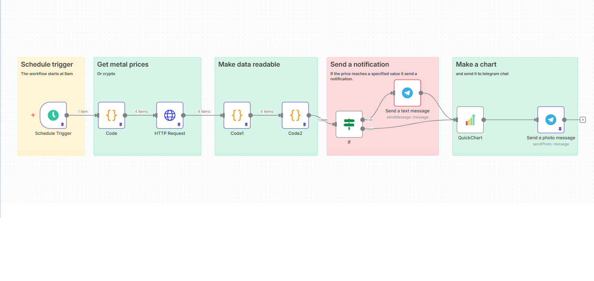

# n8n-metals-price-tracker
An automated n8n workflow to track metal prices, process market data, send Telegram notifications, and generate price charts.
# 🪙 Automated Metals Price Tracker

An automated **n8n workflow** designed to retrieve metal prices, process market data, send notifications through Telegram, and generate price charts for easier monitoring and visualization.

## 🚀 Project Overview

This project automates the process of tracking metal prices using n8n. It collects price data, transforms it into a readable format, sends notifications, and generates a chart to visualize market information.

## ⚙️ Workflow Architecture

The workflow consists of five main stages:

1. **Schedule Trigger** – Automatically starts the workflow at scheduled intervals.
2. **Get Metals Prices** – Retrieves metal price data from an external source.
3. **Make Data Readable** – Processes and formats the collected data.
4. **Send a Notification** – Sends updates through Telegram.
5. **Make a Chart** – Generates a visual representation of the price data.

## 🛠️ Technologies Used

- **n8n** – Workflow automation.
- **HTTP Request** – Data retrieval.
- **JavaScript** – Data processing and formatting.
- **Telegram** – Automated notifications.
- **Chart Generation** – Price data visualization.

## 📋 Requirements

- An n8n instance.
- Access to the metal price data source.
- Telegram Bot credentials.
- Any required API credentials.

## 🔧 Setup

1. Download the workflow JSON file from this repository.
2. Open your n8n instance.
3. Import the workflow.
4. Configure the required API credentials.
5. Configure your Telegram Bot.
6. Activate the workflow and customize the schedule.

## 📸 Workflow Preview

The workflow is organized into five stages, from scheduled execution to price visualization.

## 🎯 Project Goals

- Automate metal price monitoring.
- Reduce manual data collection.
- Receive automated price notifications.
- Visualize market data through charts.

## 👨‍💻 Author

**Mouadh Hadid**

AI Automation Developer | n8n | Python | JavaScript

---

*This project was built as part of my portfolio in workflow automation and AI-powered solutions.*

